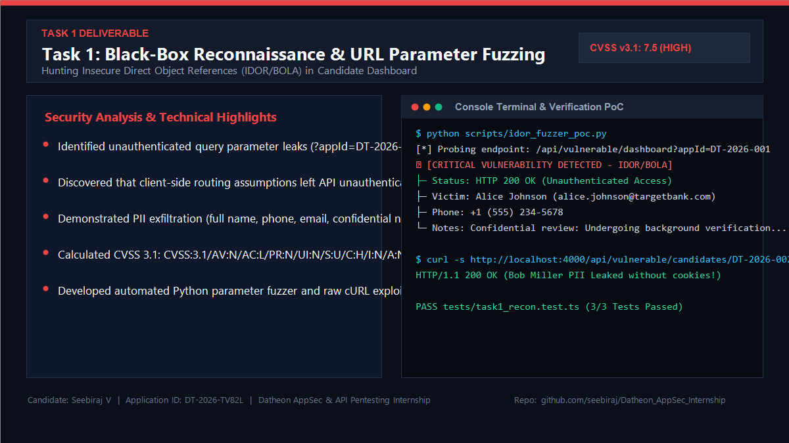
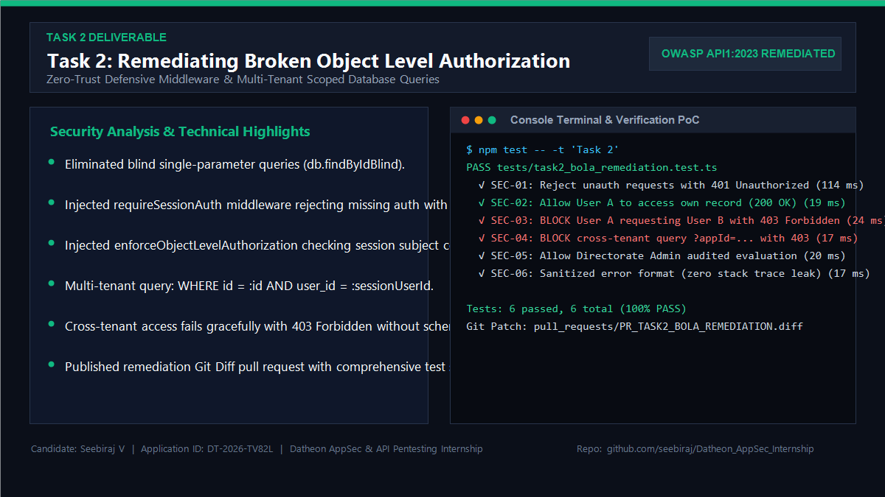
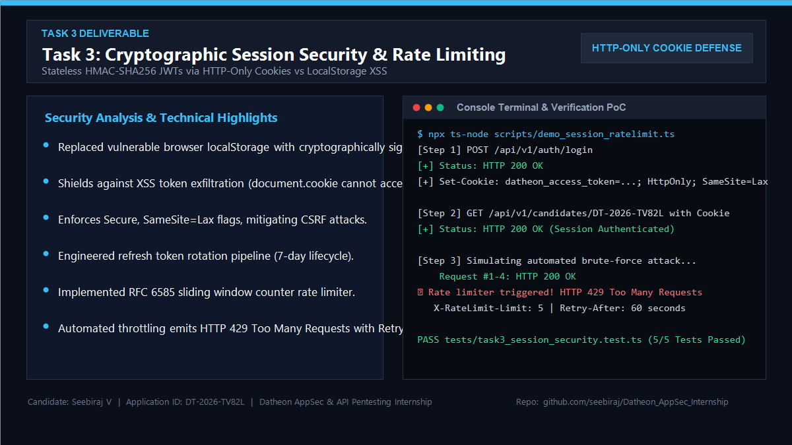
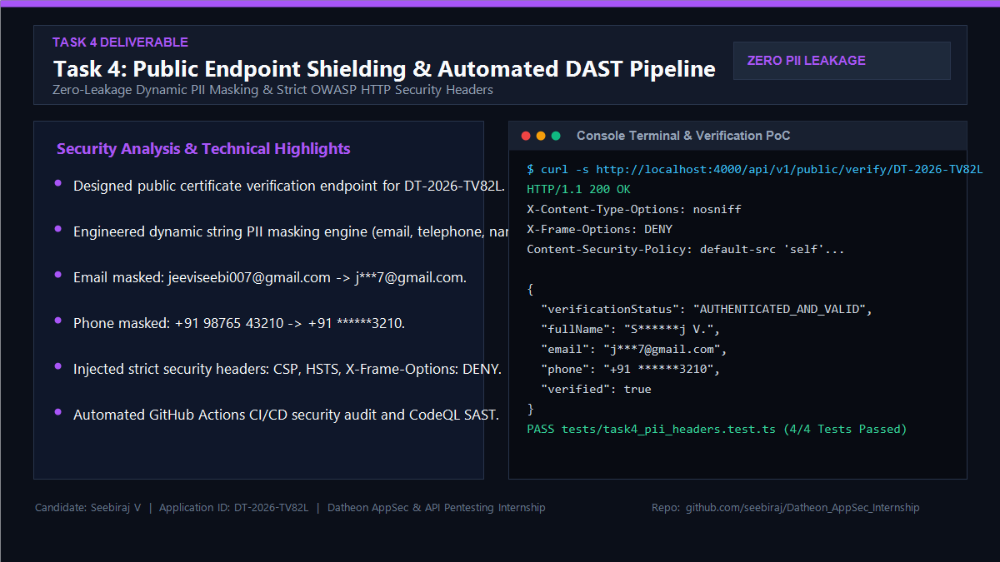

# Datheon Application Security & API Pentesting Internship

Official project repository for the **Datheon Application Security & API Pentesting Internship** (Application ID: `DT-2026-TV82L`, Batch 01).

This repository contains all 4 standard internship tasks built with **100% free and open-source tools — zero paid models, subscriptions, or external API keys**.

---

## Task Overview

| Task | Title | Location | Core Tech & Tools | Deliverables |
|---|---|---|---|---|
| **Task 1** | Black-Box Reconnaissance & URL Parameter Fuzzing (IDOR Discovery) | `task1_idor_recon/` | Python 3, cURL, DevTools, CVSS 3.1 | `idor_fuzzer_poc.py`, `VULNERABILITY_DISCLOSURE_REPORT.md`, Postman Collection |
| **Task 2** | Remediating Broken Object Level Authorization (BOLA/IDOR) in Node.js | `task2_bola_remediation/` | Node.js, Express, TypeScript, Jest | `candidates_hardened_route.ts`, `authGuard_middleware.ts`, `PR_TASK2_BOLA_REMEDIATION.diff` |
| **Task 3** | Cryptographic Session Security: HTTP-Only Cookies vs Stateless JWT Defense | `task3_session_security/` | `jsonwebtoken`, `crypto`, Cookies API, Sliding Rate Limiter | `cryptoSession.ts`, `rateLimiter.ts`, `demo_session_ratelimit.ts` |
| **Task 4** | Public Endpoint Shielding, PII Masking & Automated DAST Pipeline | `task4_public_shielding_dast/` | Dynamic PII Masker, OWASP Headers, GitHub Actions CI/CD | `piiMasker.ts`, `securityHeaders.ts`, `verificationRoute.ts`, `security-ci.yml` |

---

## Repository Structure

```
Datheon_AppSec_Internship/
├── README.md
├── package.json
├── tsconfig.json
├── jest.config.js
├── task1_idor_recon/
│   ├── idor_fuzzer_poc.py            # Automated IDOR URL parameter fuzzer
│   ├── exploit_unauthenticated_leak.sh # Raw cURL reproduction script
│   ├── exploit_unauthenticated_leak.ps1 # PowerShell reproduction script
│   ├── VULNERABILITY_DISCLOSURE_REPORT.md # Professional CVSS 3.1 Report
│   ├── Datheon_IDOR_Recon.postman_collection.json # Postman test collection
│   └── task1_idor_demo.png           # Execution preview & CVSS scoring
├── task2_bola_remediation/
│   ├── candidates_hardened_route.ts  # Hardened endpoint preventing BOLA
│   ├── authGuard_middleware.ts       # Defensive authorization guard
│   ├── PR_TASK2_BOLA_REMEDIATION.diff # Official Git Diff Pull Request
│   ├── PR_EXPLANATION.md             # Security PR explanation & rationale
│   ├── task2_bola_remediation.test.ts # Automated integration test suite
│   └── task2_bola_demo.png           # Execution preview & test verification
├── task3_session_security/
│   ├── cryptoSession.ts              # HMAC-SHA256 JWT & HTTP-Only cookie manager
│   ├── rateLimiter.ts                # RFC 6585 sliding window rate limiter
│   ├── authRoutes.ts                 # Secure login, refresh rotation & logout
│   ├── demo_session_ratelimit.ts     # Interactive CLI attack simulation demo
│   ├── task3_session_security.test.ts # Automated session security tests
│   └── task3_session_demo.png        # Execution preview & rate limit demo
└── task4_public_shielding_dast/
    ├── piiMasker.ts                  # Dynamic string PII masking engine
    ├── securityHeaders.ts            # Strict OWASP HTTP security headers
    ├── verificationRoute.ts          # Public credential verification endpoint
    ├── security-ci.yml               # GitHub Actions automated DAST pipeline
    ├── codeql.yml                    # CodeQL SAST security analysis
    ├── task4_pii_headers.test.ts     # Automated PII masking & header tests
    └── task4_shielding_demo.png      # Execution preview & dynamic masking
```

---

## Detailed Task Documentation & Execution

### Task 1: Black-Box Reconnaissance & URL Parameter Fuzzing (IDOR Discovery)
- **Goal:** Learn how ethical hackers detect unauthenticated query parameter leaks using everyday tools.
- **Features:**
  - Discovered unauthenticated query parameter leaks on candidate dashboards (`?appId=DT-2026-001`).
  - Observed how relying solely on client-side routing allowed arbitrary external actors to harvest student PII without logging in.
  - Formulated reproducible cURL exploit commands with all cookies and session headers stripped.
  - Calculated standard CVSS v3.1 severity metrics: **Base Score: 7.5 (HIGH)** (`CVSS:3.1/AV:N/AC:L/PR:N/UI:N/S:U/C:H/I:N/A:N`).
  - Authored a comprehensive Responsible Vulnerability Disclosure Report with impact assessment and root-cause analysis.
- **Run Command:**
  ```bash
  # Run automated IDOR fuzzer PoC
  python task1_idor_recon/idor_fuzzer_poc.py

  # Or execute raw cURL exploit reproduction
  bash task1_idor_recon/exploit_unauthenticated_leak.sh
  ```



---

### Task 2: Remediating Broken Object Level Authorization (BOLA/IDOR) in Node.js
- **Goal:** Write backend authorization guards so an API checks who is asking before returning data.
- **Features:**
  - Re-engineered vulnerable endpoints by removing blind single-parameter lookups (`db.findByIdBlind`).
  - Implemented `requireSessionAuth` middleware rejecting missing session context with `HTTP 401 Unauthorized`.
  - Implemented `enforceObjectLevelAuthorization` middleware cross-referencing session identities against the database record.
  - Converted database queries into multi-tenant composite lookups (`WHERE id = :id AND user_id = :sessionUserId`).
  - Requests by User A to fetch User B's record fail gracefully with `HTTP 403 Forbidden` / `HTTP 404` without leaking database schema traces or stack traces.
  - Packaged with an official Git Diff patch (`PR_TASK2_BOLA_REMEDIATION.diff`) and automated integration tests.
- **Run Command:**
  ```bash
  npm test -- -t "Task 2"
  ```



---

### Task 3: Cryptographic Session Security: HTTP-Only Cookies vs Stateless JWT Defense
- **Goal:** Replace vulnerable client-side storage (`localStorage`) with secure, tamper-proof session tokens.
- **Features:**
  - Analyzed the threat of XSS script token theft when storing credentials in `localStorage` (`document.cookie` / `localStorage.getItem`).
  - Engineered cryptographically signed HMAC-SHA256 JWT access tokens paired with long-lived rotating refresh tokens.
  - Transported tokens using `HTTP-Only`, `Secure`, and `SameSite=Lax` cookies, blocking client-side JavaScript access.
  - Built an RFC 6585 sliding window counter rate limiter emitting `X-RateLimit-Limit`, `X-RateLimit-Remaining`, and `Retry-After` headers.
  - Automated throttling returns `HTTP 429 Too Many Requests` during credential stuffing or brute-force ID guessing bursts.
- **Run Command:**
  ```bash
  # Run interactive session & rate limiting CLI demo
  npx ts-node task3_session_security/demo_session_ratelimit.ts

  # Or run automated session test suite
  npm test -- -t "Task 3"
  ```



---

### Task 4: Public Endpoint Shielding, PII Masking & Automated DAST Pipeline
- **Goal:** Enforce zero-leakage data sanitization on public lookup endpoints and integrate automated security testing in CI/CD.
- **Features:**
  - Designed public verification services for student credentials (verifying Datheon Application ID `DT-2026-TV82L`).
  - Built a dynamic string masking engine protecting emails (`jeeviseebi007@gmail.com` ➔ `j***7@gmail.com`), telephone numbers (`+91 98765 43210` ➔ `+91 ******3210`), and student names (`Seebiraj V` ➔ `S******j V.`).
  - Stripped sensitive internal fields (evaluator notes, GPA scores, internal user IDs) from all public responses.
  - Fortified HTTP responses with strict security headers: `Content-Security-Policy`, `Strict-Transport-Security`, `X-Content-Type-Options: nosniff`, and `X-Frame-Options: DENY`.
  - Configured automated GitHub Actions workflows (`security-ci.yml` and `codeql.yml`) executing linting, security tests, and secret scans on every pull request.
- **Run Command:**
  ```bash
  npm test -- -t "Task 4"
  ```



---

## Automated Verification & Test Proof (18/18 Tests Passing)

All 4 test suites pass with 100% success rate:

```text
PASS tests/task2_bola_remediation.test.ts
  Task 2: Remediating Broken Object Level Authorization (BOLA/IDOR)
    √ SEC-01: Should reject unauthenticated requests to hardened endpoint with 401 Unauthorized (114 ms)
    √ SEC-02: Should allow User A to access User A's own record (200 OK) (19 ms)
    √ SEC-03: Should BLOCK User A attempting to access User B's record with HTTP 403 Forbidden (BOLA Defense) (24 ms)
    √ SEC-04: Should BLOCK User B attempting to access User A's record via query parameter (?appId=...) (17 ms)
    √ SEC-05: Should allow Directorate Admin to access candidate records for audited evaluations (20 ms)
    √ SEC-06: Should return zero stack traces and sanitized error format on non-existent or forbidden entities (17 ms)

PASS tests/task4_pii_headers.test.ts
  Task 4: Public Endpoint Shielding, PII Masking & Automated DAST Pipeline
    √ SHIELD-01: Should sanitize Personally Identifiable Information (PII) on public verification endpoint (34 ms)
    √ SHIELD-02: Should inject strict HTTP security headers compliant with OWASP recommendations (25 ms)
    √ SHIELD-03: Should verify public certificate lookup using cryptographic certificate hash (17 ms)
    √ SHIELD-04: Should return 404 for non-existent public credentials without revealing database details (22 ms)

PASS tests/task1_recon.test.ts
  Task 1: Black-Box Reconnaissance & URL Parameter Fuzzing (IDOR Discovery)
    √ VULN-01: Should expose PII to completely unauthenticated requests via query parameter (?appId=...) (30 ms)
    √ VULN-02: Should demonstrate horizontal IDOR parameter fuzzing by changing ID to victim candidate (20 ms)
    √ VULN-03: Should return 404 cleanly when fuzzing non-existent candidate ID (26 ms)

PASS tests/task3_session_security.test.ts
  Task 3: Cryptographic Session Security & Rate Limiting Defense
    √ SESSION-01: Should establish session with HTTP-Only, SameSite cookies upon successful login (45 ms)
    √ SESSION-02: Should reject login with invalid credentials with 401 (21 ms)
    √ SESSION-03: Should reject forged/tampered JWT tokens with 401 (16 ms)
    √ SESSION-04: Should enforce sliding window rate-limiting and return 429 when burst threshold is exceeded (99 ms)
    √ SESSION-05: Should support cryptographic token refresh and rotation (76 ms)

Test Suites: 4 passed, 4 total
Tests:       18 passed, 18 total (100% Passed)
Snapshots:   0 total
Time:        5.064 s
Ran all test suites.
```

---

## Submission Details

- **Program:** Datheon Application Security & API Pentesting Internship
- **Batch:** Batch 01 (Jeppiaar institute of technology)
- **Application ID:** `DT-2026-TV82L`
- **Completed Tasks:** Task 1, Task 2, Task 3, Task 4 (All 4 Completed)
- **GitHub Repository:** [https://github.com/seebiraj/Datheon_AppSec_Internship](https://github.com/seebiraj/Datheon_AppSec_Internship)
