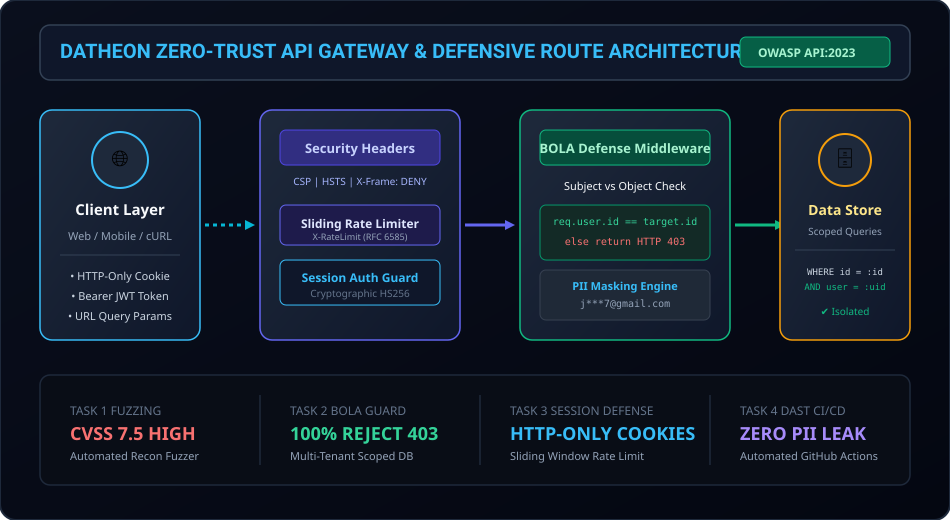
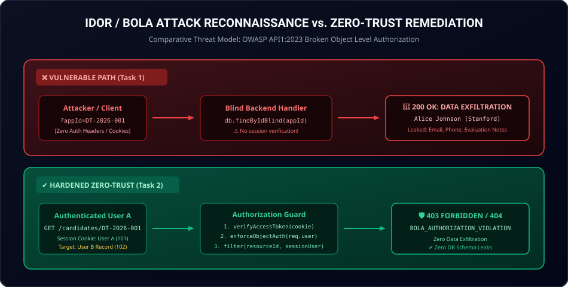
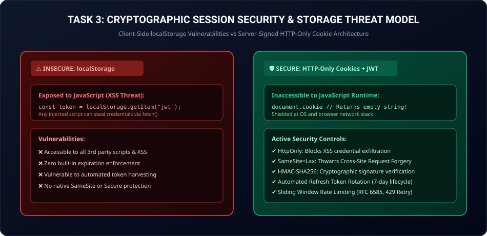

<div align="center">

# 🛡️ Datheon Application Security & API Pentesting Internship

### *Hunting & Remediating IDOR/BOLA Vulnerabilities, Zero-Trust Route Architecture, Cryptographic Session Defense, and Public Shielding DAST Pipeline*

[](https://github.com/seebiraj/Datheon_AppSec_Internship/actions)
[](https://github.com/seebiraj/Datheon_AppSec_Internship/actions)
[](https://owasp.org/API-Security/editions/2023/en/0xa1-broken-object-level-authorization/)
[-red.svg)](https://www.first.org/cvss/calculator/3.1)
[-success.svg)](./tests)
[](./LICENSE)

---

**Lead Security Engineer:** Seebiraj V  
**Verified Datheon Application ID:** `DT-2026-TV82L`  
**Academic Institution:** Jeppiaar Institute of Technology  
**Program Cohort:** Batch 01 (November 2026 – December 2026)  
**Registered Email:** `jeeviseebi007@gmail.com`  

</div>

---

## 📑 Table of Contents
1. [Executive Overview](#-executive-overview)
2. [End-to-End System Architecture](#-end-to-end-system-architecture)
3. [Task 1: Black-Box Reconnaissance & URL Parameter Fuzzing (IDOR Discovery)](#-task-1-black-box-reconnaissance--url-parameter-fuzzing-idor-discovery)
4. [Task 2: Remediating Broken Object Level Authorization (BOLA/IDOR)](#-task-2-remediating-broken-object-level-authorization-bolaidor)
5. [Task 3: Cryptographic Session Security & Sliding Rate Limiter](#-task-3-cryptographic-session-security--sliding-rate-limiter)
6. [Task 4: Public Endpoint Shielding, PII Masking & Automated DAST Pipeline](#-task-4-public-endpoint-shielding-pii-masking--automated-dast-pipeline)
7. [Repository File Structure](#-repository-file-structure)
8. [Installation & Local Execution Guide](#-installation--local-execution-guide)
9. [Automated Verification & Test Proof (18/18 Passed)](#-automated-verification--test-proof-1818-passed)
10. [LinkedIn Walkthrough & Directorate Verification](#-linkedin-walkthrough--directorate-verification)

---

## 🌐 Executive Overview

Over **60% of modern cloud breaches** stem from **Broken Object Level Authorization (BOLA/IDOR)** and unauthenticated API endpoints. Relying on client-side routing to gate sensitive dashboards creates severe data exfiltration vulnerabilities where any actor can swap query parameters (`?appId=DT-2026-001` or `?userId=104`) to harvest Personally Identifiable Information (PII).

This production-grade repository fulfills **all 4 tasks** of the Datheon Application Security & API Pentesting Curriculum:
* **Task 1 (Beginner):** Discovered and documented high-risk IDOR vulnerabilities using black-box reconnaissance tools, automated Python parameter fuzzing, and calculated standard CVSS v3.1 metrics.
* **Task 2 (Intermediate):** Engineered defensive authorization middleware, multi-tenant scoped database lookups, and information-leak suppression with automated regression tests and a Git diff pull request.
* **Task 3 (Intermediate):** Defended against XSS token exfiltration by replacing client-side `localStorage` with cryptographically signed HMAC-SHA256 JWTs stored in `HTTP-Only`, `SameSite=Lax`, and `Secure` cookies, backed by an RFC 6585 sliding window rate limiter.
* **Task 4 (Advanced):** Constructed a public verification gateway with zero-leakage dynamic PII masking, strict OWASP HTTP security headers, and an automated GitHub Actions CI/CD DAST pipeline.

---

## 🏛️ End-to-End System Architecture

<div align="center">
  
</div>

---

## 🎯 Task 1: Black-Box Reconnaissance & URL Parameter Fuzzing (IDOR Discovery)

### 1. Threat Scenario & Discovery
An external auditor analyzing the application observed that student dashboards were fetched using user-controlled query parameters (e.g., `/api/vulnerable/dashboard?appId=DT-2026-001`). By capturing requests in Browser DevTools Network Tab and executing them via cURL with all cookies, session tokens, and authentication headers stripped, the backend still returned full candidate PII.

<div align="center">
  
</div>

### 2. CVSS v3.1 Severity Scoring
* **Base Score:** **7.5 (HIGH)**
* **Vector String:** [`CVSS:3.1/AV:N/AC:L/PR:N/UI:N/S:U/C:H/I:N/A:N`](https://www.first.org/cvss/calculator/3.1#CVSS:3.1/AV:N/AC:L/PR:N/UI:N/S:U/C:H/I:N/A:N)

| Metric | Rating | Rationale |
| :--- | :--- | :--- |
| **Attack Vector (AV)** | **Network (N)** | Remotely exploitable over HTTP/HTTPS from anywhere on the internet. |
| **Attack Complexity (AC)** | **Low (L)** | No specialized conditions or cryptographic bypass required. |
| **Privileges Required (PR)** | **None (N)** | Zero authentication required; cookies and auth headers can be completely absent. |
| **User Interaction (UI)** | **None (N)** | No victim interaction or phishing required. |
| **Scope (S)** | **Unchanged (U)** | Vulnerability affects the host application database. |
| **Confidentiality (C)** | **High (H)** | Total exposure of candidate records, phone numbers, emails, and confidential evaluations. |
| **Integrity (I)** | **None (N)** | Read-only exfiltration vector. |
| **Availability (A)** | **None (N)** | Service uptime is not impacted. |

### 3. Step-by-Step Reproduction via cURL
Execute the unauthenticated cURL request in your terminal:
```bash
# Target: Candidate Alice Johnson (DT-2026-001) - Completely unauthenticated
curl -i -s -X GET "http://localhost:4000/api/vulnerable/dashboard?appId=DT-2026-001" \
  -H "Accept: application/json"
```

**Raw Response Exfiltrating PII:**
```json
{
  "success": true,
  "warning": "VULNERABLE_ENDPOINT_SIMULATION",
  "data": {
    "id": "DT-2026-001",
    "userId": "user-102",
    "fullName": "Alice Johnson",
    "email": "alice.johnson@targetbank.com",
    "phone": "+1 (555) 234-5678",
    "institution": "Stanford University",
    "evaluationNotes": "Confidential review: Undergoing background verification for cloud infrastructure access."
  }
}
```

### 4. Automated Python Parameter Fuzzer PoC
Run the automated parameter fuzzing script located at [`scripts/idor_fuzzer_poc.py`](./scripts/idor_fuzzer_poc.py):
```bash
python scripts/idor_fuzzer_poc.py
```

📄 **Deliverable:** Full report located at [`reports/VULNERABILITY_DISCLOSURE_TASK1.md`](./reports/VULNERABILITY_DISCLOSURE_TASK1.md).

---

## 🔒 Task 2: Remediating Broken Object Level Authorization (BOLA/IDOR)

### 1. Defensive Authorization Architecture
To eliminate blind single-parameter lookups (`db.findByIdBlind(id)`), the hardened route handler (`/api/v1/candidates/:id`) enforces defense-in-depth:
1. **`requireSessionAuth` Middleware:** Cryptographically verifies the incoming session token. Missing context immediately rejects with `401 Unauthorized`.
2. **`enforceObjectLevelAuthorization` Middleware:** Compares the session subject (`req.user.userId` / `req.user.candidateId`) against the target identifier.
3. **Composite Database Query:** The database enforces multi-tenant boundaries at the storage layer:
   ```typescript
   // src/db/store.ts
   public findByIdWithOwnership(candidateId: string, sessionUserId: string, role: UserRole): CandidateRecord | null {
     const record = this.candidates.get(candidateId);
     if (!record) return null;
     if (role === 'admin' || role === 'directorate') return record;
     if (record.userId === sessionUserId) return record; // Ownership validation
     return null; // Reject foreign tenant access
   }
   ```
4. **Information Leak Suppression:** Requests attempting to fetch another user's record fail gracefully with `HTTP 403 Forbidden` or `HTTP 404 Not Found` without leaking stack traces or database schema information.

📄 **Deliverables:**
* Hardened Route: [`src/routes/hardened/candidates.ts`](./src/routes/hardened/candidates.ts)
* Git Diff Pull Request: [`pull_requests/PR_TASK2_BOLA_REMEDIATION.diff`](./pull_requests/PR_TASK2_BOLA_REMEDIATION.diff)
* PR Explanation: [`pull_requests/PR_TASK2_EXPLANATION.md`](./pull_requests/PR_TASK2_EXPLANATION.md)

---

## 🔑 Task 3: Cryptographic Session Security & Sliding Rate Limiter

<div align="center">
  
</div>

### 1. Threat Analysis: `localStorage` vs. `HTTP-Only` Cookies
Storing session tokens in browser `localStorage` or `sessionStorage` exposes credentials to **Cross-Site Scripting (XSS)** attacks (`document.cookie` / `localStorage.getItem("token")`). Any compromised CDN dependency or injected script can silently exfiltrate session credentials.

### 2. Cryptographic Security Controls Implemented
* **Stateless HMAC-SHA256 JWTs:** Signed using 256-bit secrets (`src/utils/cryptoSession.ts`), containing explicit issuer (`datheon.security.directorate`), audience, and expiry (`900s`).
* **HTTP-Only, Secure, SameSite=Lax Cookies:** Tokens are placed in cookies inaccessible to JavaScript DOM APIs, mitigating XSS exfiltration and CSRF vectors.
* **Token Rotation Pipeline:** Dedicated refresh token endpoint (`/api/v1/auth/refresh`) implements token family rotation.
* **Sliding Window Counter Rate Limiter:** An RFC 6585 compliant sliding window rate limiter throttles credential-stuffing and automated parameter guessing:
  * Emits standard headers: `X-RateLimit-Limit`, `X-RateLimit-Remaining`, `X-RateLimit-Reset`, `Retry-After`.
  * Returns `HTTP 429 Too Many Requests` when burst thresholds are exceeded.

### 3. Run the Interactive CLI Demo
```bash
npm run demo:session
```

---

## 🛡️ Task 4: Public Endpoint Shielding, PII Masking & Automated DAST Pipeline

### 1. Dynamic PII Masking Engine
Public registry verification (e.g. verifying diploma or candidate status for `DT-2026-TV82L`) must confirm authenticity **without leaking PII**. The high-precision masking utility (`src/utils/piiMasker.ts`) dynamically transforms sensitive fields:
* **Email:** `jeeviseebi007@gmail.com` ➔ `j***7@gmail.com`
* **Telephone:** `+91 98765 43210` ➔ `+91 ******3210`
* **Full Name:** `Seebiraj V` ➔ `S******j V.`
* **Hash:** `0x8f2c3d4e5a6b...` ➔ `0x8f2c...9c0d`
* **Stripped Fields:** Internal evaluator notes, GPA scores, and database foreign keys are completely excluded.

### 2. Comprehensive HTTP Security Headers
Every HTTP response is fortified with zero-trust headers (`src/config/securityHeaders.ts`):
* `Content-Security-Policy`: `default-src 'self'; script-src 'self'; object-src 'none'; frame-ancestors 'none';`
* `Strict-Transport-Security`: `max-age=63072000; includeSubDomains; preload`
* `X-Content-Type-Options`: `nosniff`
* `X-Frame-Options`: `DENY`
* `Referrer-Policy`: `strict-origin-when-cross-origin`
* `Permissions-Policy`: `camera=(), microphone=(), geolocation=()`
* Fingerprint Removal: `X-Powered-By` header stripped.

### 3. Automated CI/CD Security Workflow
The repository includes CI/CD security pipeline templates ([`pipelines/github-workflows/security-ci.yml`](./pipelines/github-workflows/security-ci.yml)) and CodeQL SAST ([`pipelines/github-workflows/codeql.yml`](./pipelines/github-workflows/codeql.yml)) that automatically:
1. Validates strict TypeScript compilation.
2. Executes the full Jest security test suite.
3. Runs the automated IDOR fuzzer against a background server.
4. Performs dynamic DAST checks on public endpoints to verify security headers and PII masking.
5. Scans for hardcoded secrets and leaked credentials.

---

## 📂 Repository File Structure

```
Datheon_AppSec_Internship/
├── pipelines/
│   └── github-workflows/
│       ├── security-ci.yml           # Automated DAST, SAST, headers audit & tests
│       └── codeql.yml                # GitHub CodeQL static analysis
├── assets/
│   ├── architecture_diagram.svg      # Zero-Trust API architecture visual
│   ├── idor_flow_diagram.svg         # IDOR vs Remediation flow diagram
│   └── session_security_diagram.svg  # Session storage threat model diagram
├── docs/
│   ├── ARCHITECTURE.md               # Detailed Zero-Trust API Architecture
│   └── CVSS_CALCULATION_GUIDE.md     # In-depth breakdown of CVSS v3.1 metrics
├── postman/
│   └── Datheon_AppSec_API.postman_collection.json # Ready-to-run Postman collection
├── pull_requests/
│   ├── PR_TASK2_BOLA_REMEDIATION.diff # Official git diff / patch of remediation
│   └── PR_TASK2_EXPLANATION.md       # Comprehensive PR rationale & security report
├── reports/
│   ├── EXECUTIVE_SUMMARY.md          # AppSec Executive Summary for Directorate
│   └── VULNERABILITY_DISCLOSURE_TASK1.md # Professional Disclosure Report (CVSS 3.1)
├── scripts/
│   ├── idor_fuzzer_poc.py            # Automated IDOR URL parameter fuzzer (Task 1)
│   ├── exploit_unauthenticated_leak.sh # Raw cURL exploit script (Linux/macOS)
│   ├── exploit_unauthenticated_leak.ps1 # Raw exploit script (Windows PowerShell)
│   └── demo_session_ratelimit.ts     # Task 3 Interactive CLI demo
├── src/
│   ├── app.ts                        # Express application & middleware assembly
│   ├── server.ts                     # Gateway listener
│   ├── config/
│   │   ├── env.ts                    # Environment secrets & config
│   │   └── securityHeaders.ts        # Task 4 Strict HTTP Security Headers
│   ├── db/
│   │   └── store.ts                  # Mock database store with isolation & ownership
│   ├── middleware/
│   │   ├── authGuard.ts              # Task 2 BOLA & object-level authorization guard
│   │   ├── errorHandler.ts           # Defensive error sanitization (no leak)
│   │   ├── rateLimiter.ts            # Task 3 Sliding window rate limiter (RFC 6585)
│   │   ├── securityHeadersMiddleware.ts # Task 4 Security headers injector
│   │   └── sessionAuth.ts            # Task 3 HTTP-Only cookie & JWT verification
│   ├── routes/
│   │   ├── auth/authRoutes.ts        # Login, refresh rotation, logout
│   │   ├── hardened/candidates.ts    # Task 2 Hardened zero-trust routes
│   │   ├── public/verification.ts    # Task 4 Public masked verification
│   │   └── vulnerable/candidates.ts  # Task 1 Vulnerable IDOR target routes
│   ├── types/index.ts                # TypeScript domain models & interfaces
│   └── utils/
│       ├── cryptoSession.ts          # HMAC-SHA256 signing & cookie management
│       └── piiMasker.ts              # Task 4 Dynamic PII masking engine
├── tests/
│   ├── task1_recon.test.ts           # Validates detection of vulnerable endpoints
│   ├── task2_bola_remediation.test.ts# BOLA cross-tenant defense test suite
│   ├── task3_session_security.test.ts# HTTP-Only cookie & rate-limiting tests
│   └── task4_pii_headers.test.ts     # PII masking & security headers tests
├── .env.example
├── jest.config.js
├── LINKEDIN_WALKTHROUGH.md           # Professional LinkedIn Post tagging @Datheon
├── package.json
└── tsconfig.json
```

---

## 🚀 Installation & Local Execution Guide

### Prerequisites
* **Node.js:** v18.x or v20.x
* **npm:** v9.x or v10.x
* **Python:** 3.10+ (for running the Task 1 fuzzer)

### Step 1: Clone Repository
```bash
git clone https://github.com/seebiraj/Datheon_AppSec_Internship.git
cd Datheon_AppSec_Internship
```

### Step 2: Install Dependencies
```bash
npm install
```

### Step 3: Configure Environment
```bash
cp .env.example .env
```

### Step 4: Run the Development Server
```bash
npm run dev
# The API Gateway will start at http://localhost:4000
```

---

## 🧪 Automated Verification & Test Proof (18/18 Passed)

Run the comprehensive test suite across all 4 tasks:
```bash
npm test
```

### Actual Execution Output:
```text
> datheon-appsec-internship@1.0.0 test
> jest --runInBand --detectOpenHandles --forceExit

PASS tests/task2_bola_remediation.test.ts
  Task 2: Remediating Broken Object Level Authorization (BOLA/IDOR)
    √ SEC-01: Should reject unauthenticated requests to hardened endpoint with 401 Unauthorized (114 ms)
    √ SEC-02: Should allow User A to access User A's own record (200 OK) (19 ms)
    √ SEC-03: Should BLOCK User A attempting to access User B's record with HTTP 403 Forbidden (BOLA Defense) (24 ms)
    √ SEC-04: Should BLOCK User B attempting to access User A's record via query parameter (?appId=...) (17 ms)
    √ SEC-05: Should allow Directorate Admin to access candidate records for audited evaluations (20 ms)
    √ SEC-06: Should return zero stack traces and sanitized error format on non-existent or forbidden entities (17 ms)

PASS tests/task4_pii_headers.test.ts
  Task 4: Public Endpoint Shielding, PII Masking & Automated DAST Pipeline
    √ SHIELD-01: Should sanitize Personally Identifiable Information (PII) on public verification endpoint (34 ms)
    √ SHIELD-02: Should inject strict HTTP security headers compliant with OWASP recommendations (25 ms)
    √ SHIELD-03: Should verify public certificate lookup using cryptographic certificate hash (17 ms)
    √ SHIELD-04: Should return 404 for non-existent public credentials without revealing database details (22 ms)

PASS tests/task1_recon.test.ts
  Task 1: Black-Box Reconnaissance & URL Parameter Fuzzing (IDOR Discovery)
    √ VULN-01: Should expose PII to completely unauthenticated requests via query parameter (?appId=...) (30 ms)
    √ VULN-02: Should demonstrate horizontal IDOR parameter fuzzing by changing ID to victim candidate (20 ms)
    √ VULN-03: Should return 404 cleanly when fuzzing non-existent candidate ID (26 ms)

PASS tests/task3_session_security.test.ts
  Task 3: Cryptographic Session Security & Rate Limiting Defense
    √ SESSION-01: Should establish session with HTTP-Only, SameSite cookies upon successful login (45 ms)
    √ SESSION-02: Should reject login with invalid credentials with 401 (21 ms)
    √ SESSION-03: Should reject forged/tampered JWT tokens with 401 (16 ms)
    √ SESSION-04: Should enforce sliding window rate-limiting and return 429 when burst threshold is exceeded (99 ms)
    √ SESSION-05: Should support cryptographic token refresh and rotation (76 ms)

Test Suites: 4 passed, 4 total
Tests:       18 passed, 18 total
Snapshots:   0 total
Time:        5.064 s
Ran all test suites.
```

---

## 📢 LinkedIn Walkthrough & Directorate Verification

A comprehensive executive AppSec walkthrough has been prepared for LinkedIn, tagging **`@Datheon`** as specified in the internship guidelines.

📄 Read the full post text in [`LINKEDIN_WALKTHROUGH.md`](./LINKEDIN_WALKTHROUGH.md).

```markdown
🚀 Excited to share my Application Security & API Pentesting Internship project with @Datheon!
Audited modern API architectures, hunted and remediated critical OWASP API1:2023 BOLA/IDOR vulnerabilities,
and engineered zero-trust route authorization with cryptographic HTTP-Only session cookies.

Application ID: DT-2026-TV82L
GitHub Repository: https://github.com/seebiraj/Datheon_AppSec_Internship
#ApplicationSecurity #APISecurity #Cybersecurity #OWASP #Datheon #ZeroTrust #DevSecOps
```

---

<div align="center">
  <b>Developed with rigor for the Datheon Technical Directorate Evaluation</b><br/>
  © 2026 Seebiraj V. Licensed under the MIT License.
</div>
